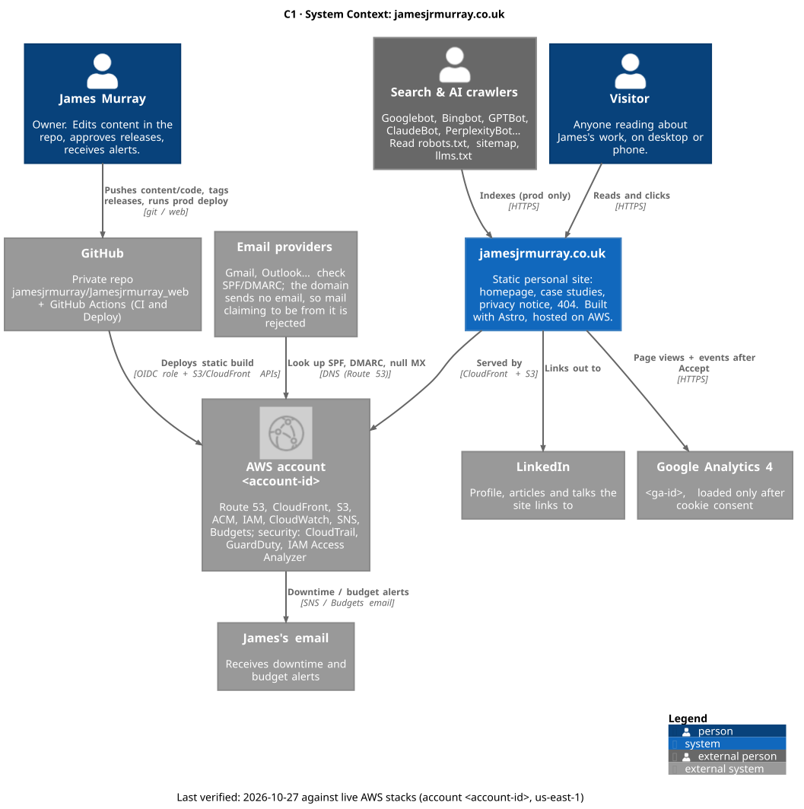
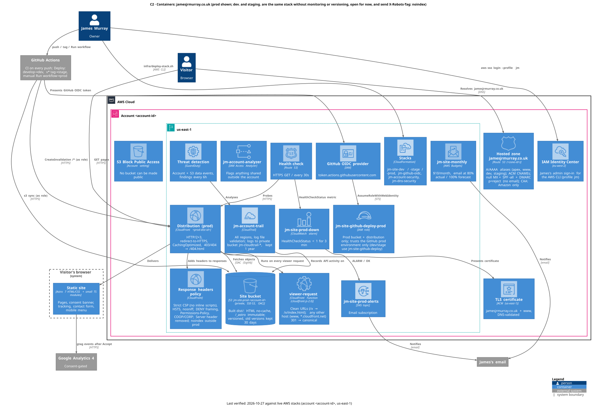
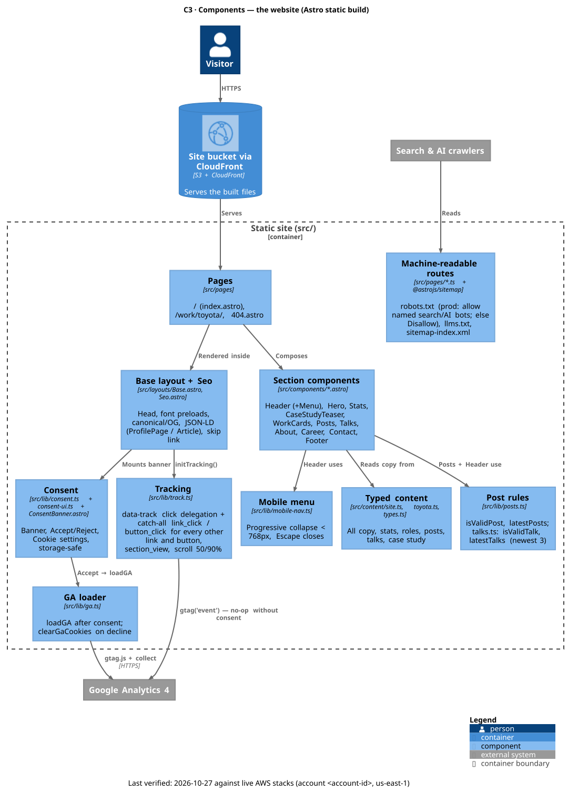
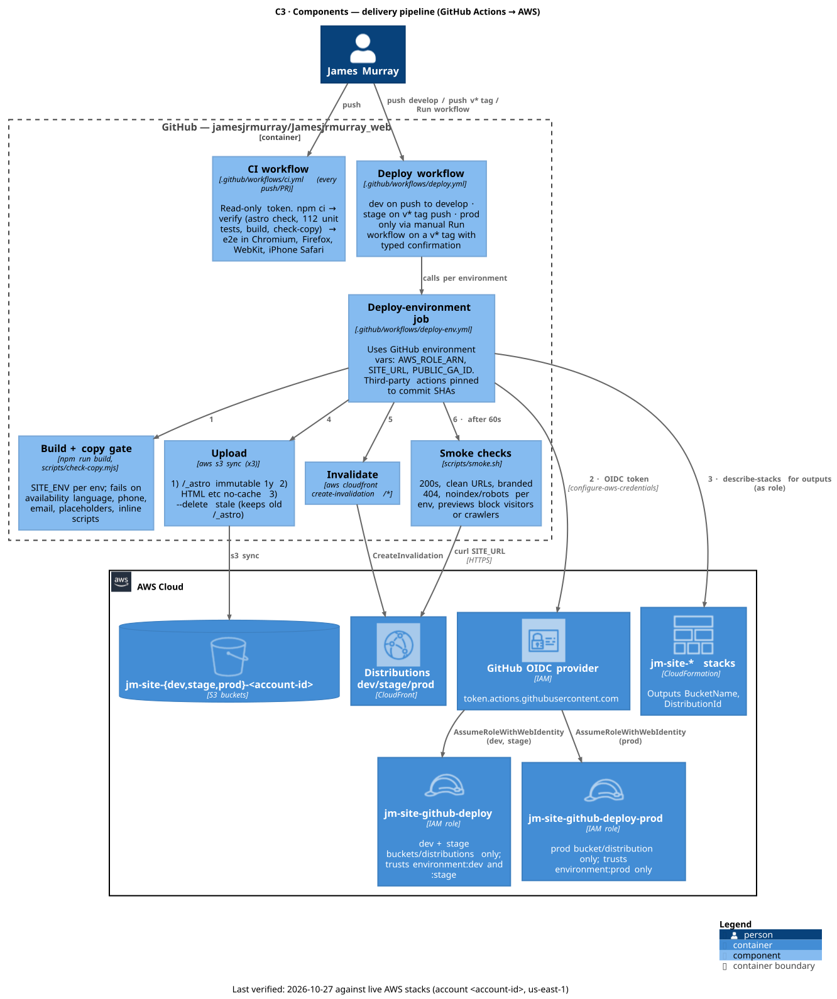
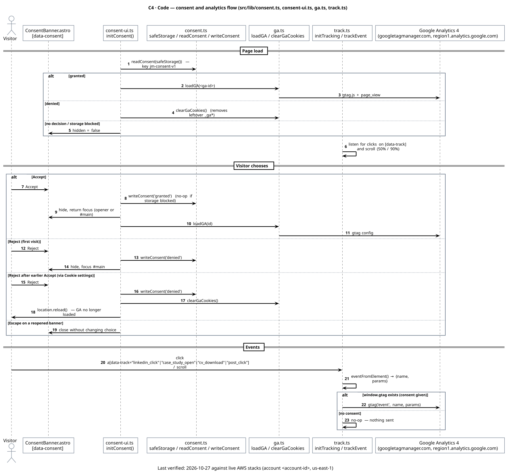
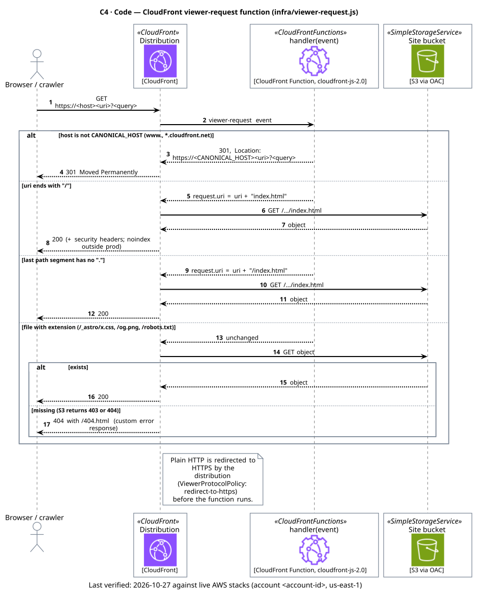

# Architecture — jamesjrmurray.co.uk (C4 model)

Diagrams-as-code in [C4-PlantUML](https://github.com/plantuml-stdlib/C4-PlantUML) **v2.14.0** with official [AWS Architecture Icons for PlantUML](https://github.com/awslabs/aws-icons-for-plantuml) **v23.1** on every AWS service. Shared includes and pinned versions: [`_common.puml`](_common.puml).

Last verified 2026-10-23 against commit `6c3353a` and the live CloudFormation stacks `jm-github-oidc`, `jm-site-dev`, `jm-site-stage`, `jm-site-prod` (account <account-id>, us-east-1).

| Level | Diagram | What it shows |
|---|---|---|
| C1 | [`c1-system-context.puml`](c1-system-context.puml) | James, visitors, search/AI crawlers; the site; GitHub, AWS, GA4, LinkedIn, email |
| C2 | [`c2-containers.puml`](c2-containers.puml) | Route 53, ACM, CloudFront + viewer-request function + headers policy, private S3 with OAC, health check → CloudWatch alarm → SNS, Budgets, IAM OIDC + deploy role, CloudFormation, Identity Center; browser, GitHub Actions, GA4 |
| C3 | [`c3-website-components.puml`](c3-website-components.puml) | Pages, machine-readable routes, layout/SEO, sections, typed content, posts, mobile menu, consent, GA loader, tracking |
| C3 | [`c3-delivery-pipeline.puml`](c3-delivery-pipeline.puml) | CI (verify + 4-browser e2e), Deploy (dev/stage/prod triggers), OIDC → role, build + copy gate, 3-pass S3 upload, invalidation, smoke checks |
| C4 | [`c4-consent-analytics.puml`](c4-consent-analytics.puml) | Page load → consent decision → GA load → events (sequence) |
| C4 | [`c4-viewer-request.puml`](c4-viewer-request.puml) | Canonical-host 301 (www, raw CloudFront address), clean URLs, 404 handling (sequence) |

## Rendered images

`rendered/` holds SVG + PNG of every diagram, rendered 2026-10-26 locally with `render.sh` (PlantUML on a Temurin 21 JRE in `~/.local/jdk`; nothing sent to an online renderer), so they show the real IDs like the sources.

| | |
|---|---|
| C1 |  |
| C2 |  |
| C3 website |  |
| C3 pipeline |  |
| C4 consent |  |
| C4 viewer-request |  |

## Re-render locally

To render SVG + PNG next to each file instead:

```bash
docs/architecture/render.sh
```

Needs **Docker** or **Java 17+** (the script downloads the PlantUML JAR on first use). No Graphviz needed (`!pragma layout smetana`). Do not paste these into public online renderers — the repo is private.

## Notes and assumptions

- **v1.0.0 was deployed to prod manually** (same steps as `deploy-env.yml`) because the *Run workflow* button only appears once `deploy.yml` is on `main`. The C3 pipeline diagram shows the intended path.
- **dev/stage** match prod except: no custom domain, no Route 53 records, no monitoring, `X-Robots-Tag: noindex`, robots.txt `Disallow: /`.

## Sources
`infra/*.yml`, `infra/viewer-request.js`, `.github/workflows/*.yml`, `scripts/smoke.sh`, `scripts/check-copy.mjs`, `src/**`, `docs/runbooks/launch.md`, and read-only AWS CLI (`describe-stacks`, `list-stack-resources`, `describe-budgets`).
